# Lab 3: Deploying a 5G Standalone Network Using OpenAirInterface

## 1. Goal

In the previous labs, you analyzed 5G signaling messages and network performance using provided captures and measurements.

In this lab, you will deploy your own 5G Standalone (SA) network using OpenAirInterface (OAI), verify the complete connection, investigate RFsimulator communication, perform active network measurements, and troubleshoot a controlled connection failure.

Unlike the previous labs, you will collect measurements directly from your own running 5G network.

**Learning Objectives**

After completing this lab, you should be able to:

1. Deploy an OAI gNB, nrUE, and 5G Core Network.
2. Identify the main stages of 5G SA connection establishment.
3. Verify communication between gNB and nrUE through RFsimulator.
4. Measure user-plane connectivity under different packet sizes.
5. Diagnose connection failures using OAI and 5GC logs.
6. Explain the limitations of a software-simulated 5G network.

## 2. Experimental Environment

The environment was prepared following the *OAI v2.4.0 Build Guide*. The OAI source tree and CN5G are installed under `~/wc_2026/` instead of `~/`; all other commands follow the guide unchanged.

| Component | Configuration |
|---|---|
| Ubuntu | **22.04.5 LTS** (kernel 5.15.0-202-generic; the guide's permitted alternative to 24.04) |
| Host | Intel Xeon Silver 4110 @ 2.10 GHz, 8 vCPU (AVX2), 8 GB RAM, VM |
| OAI RAN | v2.4.0 (`git describe --tags` → `v2.4.0`, unmodified tree) |
| 5G Core | OAI CN5G (`doc/tutorial_resources/oai-cn5g` from v2.4.0; AMF/SMF/UPF/AUSF/UDM/UDR/NRF images `develop`, MySQL 8.0) |
| gNB | nr-softmodem (`gnb.sa.band78.fr1.106PRB.usrpb210.conf`, `--rfsim`) |
| UE | nr-uesoftmodem |
| Radio interface | RFsimulator (TCP port 4043) |
| Band | n78 (DL carrier 3619.2 MHz) |
| Subcarrier spacing | 30 kHz (numerology 1) |
| Resource blocks | 106 |
| TDD pattern (from UE log) | 5 ms period: 7 DL slots, 2 UL slots, 1 mixed slot (6 DL / 4 UL symbols) |
| PLMN / S-NSSAI | MCC 001 / MNC 01, SST 1 |
| UE IMSI | 001010000000001 |
| External DN | 192.168.70.135 (`oai-ext-dn`) |

The experiment uses one Ubuntu machine without physical RF hardware.

Evidence files referenced in this report:

| Folder | Content |
|---|---|
| [`images/`](images/) | Screenshots of every task |
| [`logs/`](logs/) | Text logs captured with `tee` / `docker compose logs` (ANSI colour codes removed) |

## 3. Task 1 — Deploy and Verify the Complete 5G SA Network

Start the OAI CN5G:

```bash
cd ~/wc_2026/oai-cn5g
docker compose up -d
docker compose ps
```

The gNB and nrUE were started with the commands in the Build Guide. Their output was saved with `tee` to [`logs/task1-gnb.log`](logs/task1-gnb.log) and [`logs/task1-ue.log`](logs/task1-ue.log).

| Stage | Successful? | Evidence from logs |
|---|---|---|
| CN5G initialization | ✅ Yes | `docker compose ps`: all 10 containers (`mysql`, `ims`, `oai-nrf`, `oai-amf`, `oai-smf`, `oai-upf`, `oai-ausf`, `oai-udm`, `oai-udr`, `oai-ext-dn`) `Up … (healthy)` ([`logs/task1-cn5g-ps.txt`](logs/task1-cn5g-ps.txt)) |
| gNB NG Setup | ✅ Yes | gNB: `[NGAP] Send NGSetupRequest to AMF` → `[NGAP] Received NGSetupResponse from AMF`; AMF gNB table: `gNB-OAI · Connected · PLMN 001,01` |
| UE synchronization | ✅ Yes | UE: `[PHY] Initial sync successful, PCI: 0`; gNB: `UE RNTI 5571 CU-UE-ID 1 in-sync` |
| RRC connection establishment | ✅ Yes | UE: `Received NR_RRCSetup` → `State = NR_RRC_CONNECTED`; gNB: `(UE ID 1 RNTI 5571) Received RRCSetupComplete (RRC_CONNECTED reached)` |
| UE Registration | ✅ Yes | UE: `Received NAS_DOWNLINK_DATA_IND type FGS_REGISTRATION_ACCEPT`, `Received Registration Accept with result 3GPP`, `5G-GUTI: AMF pointer 1, AMF Set ID 1, 5G-TMSI 2256554929` |
| PDU Session Establishment | ✅ Yes | gNB: `Added PDU Session 10`, `Added DRB 1 to established list (PDU Session ID=10)`, `PDU Session Setup: ID=10, outgoing TEID=0x8459edf3, Addr=192.168.70.129`; UE: `Received PDU Session Establishment Accept, UE IPv4: 10.0.0.2` |
| UE tunnel creation | ✅ Yes | UE: `[OIP] Interface oaitun_ue1 successfully configured, IPv4 10.0.0.2` |

Key lines extracted from the saved logs, in the order they occurred:

```text
# gNB (logs/task1-gnb.log)
[NGAP]   Send NGSetupRequest to AMF
[NGAP]   Received NGSetupResponse from AMF
[NR_RRC] [UL] (cellID bc614e, UE ID 1 RNTI 5571) Received RRCSetupComplete (RRC_CONNECTED reached)
[NR_RRC] Send message to sctp: NGAP_InitialContextSetupResponse
[NR_RRC] Added PDU Session 10, (total nb of sessions = 1)
[NR_RRC] Added DRB 1 to established list (PDU Session ID=10, total DRBs = 1)
[NR_RRC] PDU Session Setup: ID=10, outgoing TEID=0x8459edf3, Addr=192.168.70.129

# nrUE (logs/task1-ue.log)
[PHY]    Initial sync successful, PCI: 0
[NR_RRC] [UE0][RAPROC] Logical Channel DL-CCCH (SRB0), Received NR_RRCSetup
[NR_RRC] State = NR_RRC_CONNECTED
[NAS]    Generate Initial NAS Message: Registration Request
[NAS]    Received Registration Accept with result 3GPP
[NR_RRC] 5G-GUTI: AMF pointer 1, AMF Set ID 1, 5G-TMSI 2256554929
[NAS]    Received PDU Session Establishment Accept, UE IPv4: 10.0.0.2
[OIP]    Interface oaitun_ue1 successfully configured, IPv4 10.0.0.2, IPv6 (null)
```

**CN5G containers**

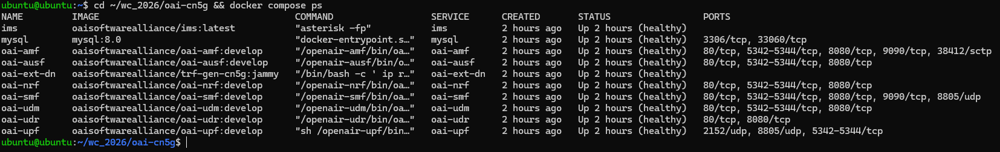

**gNB connected.** The gNB periodically reports UE RNTI 5571 as `in-sync` with DL/UL BLER 0.00000, `dlsch_errors 0`, `ulsch_errors 0`, and SNR 51 dB. The LCID 4 counters show traffic on the data radio bearer.

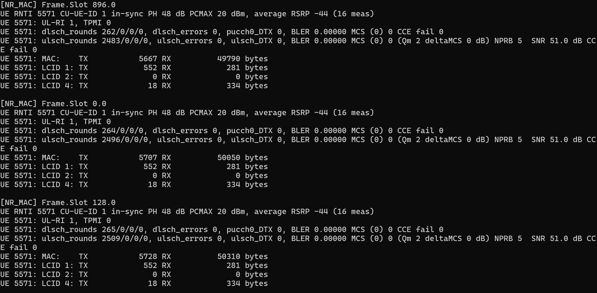

**nrUE connected.** The UE receives Registration Accept and the PDU Session Establishment Accept with IPv4 10.0.0.2, and configures `oaitun_ue1`.

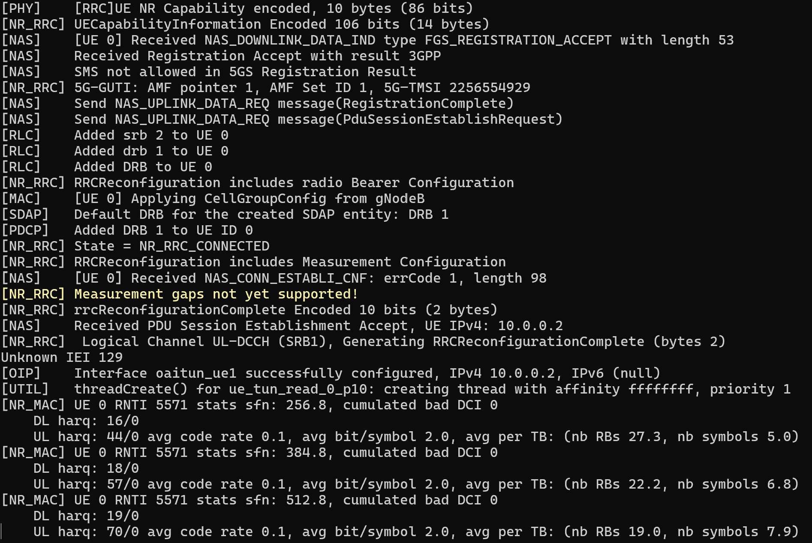

**Questions:**

1. **Does a successful NG Setup guarantee that a UE can register? Explain.**
   No. NG Setup only establishes the N2 (NGAP over SCTP) association between the gNB and the AMF; it proves that the gNB is configured with a PLMN and slice the AMF accepts. It involves no UE at all. Registration additionally requires the UE to find and synchronize to the cell, complete random access and RRC setup, and then pass NAS procedures with the core: the AMF must identify the subscriber, the AUSF/UDM must find it in the UDR and authenticate it (5G-AKA with the correct K/OPc), security mode must succeed, and the requested PLMN/NSSAI must be allowed for that subscription. Task 5 demonstrates this directly: with the same successful NG Setup, the UE with IMSI `…099` was rejected.

2. **Why can the UE establish an RRC connection but still fail Registration?**
   RRC is an Access Stratum procedure between the UE and the gNB only. The gNB does not check who the subscriber is; it only checks radio-level parameters (cell, band, numerology, random access). The Registration Request is a NAS message carried transparently inside RRC to the AMF, which then consults the AUSF/UDM/UDR. If the IMSI is not provisioned, the key or OPc is wrong, or the PLMN/slice is not allowed, the core rejects the UE even though the radio connection works. In Task 5 the gNB logged `RRC_CONNECTED reached` for the wrong-IMSI UE, yet the AMF rejected its Registration Request within 40 ms of receiving it.

3. **What additional procedure is required after Registration before user data can be exchanged?**
   A PDU Session Establishment. The UE sends a PDU Session Establishment Request (DNN, S-NSSAI) to the AMF, which forwards it to the SMF. The SMF selects a UPF, allocates the UE IP address, and sets up the N4 session and N3 GTP-U tunnel. The gNB then sets up a data radio bearer through RRC Reconfiguration. In this run that was PDU Session 10, DRB 1, and GTP-U TEIDs `0x00000001` and `0x8459edf3`. Only after that does the OAI UE create `oaitun_ue1` with the assigned IP 10.0.0.2.

## 4. Task 2 — Investigate RFsimulator Communication

OAI RFsimulator replaces the physical RF interface with software-based communication.

The gNB and nrUE exchange IQ samples through a TCP connection.

```bash
pgrep -a nr-softmodem
pgrep -a nr-uesoftmodem
sudo ss -tnp | grep 4043
sudo ss -ltnp | grep 4043
```

Raw output: [`logs/task2-rfsim.txt`](logs/task2-rfsim.txt)

| Item | Observed Value |
|---|---|
| gNB process ID | **126342** (`pgrep` also lists child 126343; `ss` shows 126342 owns the sockets) |
| nrUE process ID | **127554** (child 127555; `ss` shows 127554 owns the socket) |
| RFsimulator transport protocol | TCP |
| RFsimulator port | 4043 |
| TCP connection state | `ESTAB` (both directions); the gNB also keeps a `LISTEN` socket on `*:4043` |
| Connected process(es) | `nr-uesoftmodem` (pid 127554) `127.0.0.1:54014` ⇄ `nr-softmodem` (pid 126342) `[::ffff:127.0.0.1]:4043`: the UE is the TCP client, the gNB is the server |

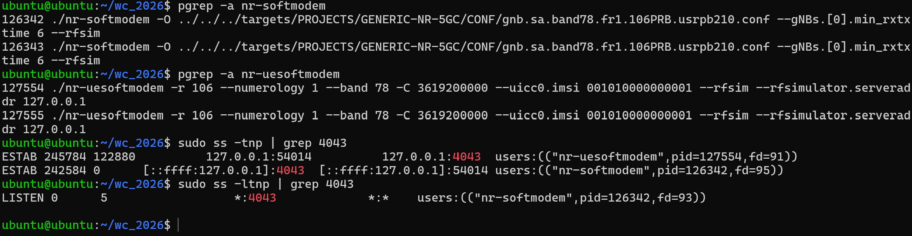

Observation: the queues on the established sockets were large (UE side Recv-Q 245784 / Send-Q 122880 bytes). This is consistent with a continuous stream of IQ samples, not occasional small packets.

**Questions:**

1. **Why does RFsimulator use a TCP connection instead of a physical antenna?**
   RFsimulator replaces the radio front end (DAC/ADC, up/down-conversion, antennas) so that the full stack can run without SDR hardware such as a USRP. The baseband IQ samples that would be sent to the radio are written to a socket instead. TCP gives reliable, in-order delivery, so no samples are lost or reordered. It also lets the gNB act as a server (`LISTEN *:4043`) and one or more UEs connect as clients, on the same host (127.0.0.1, as here) or across a network. Because the sample stream carries timestamps, the TCP link also keeps the gNB and UE sample clocks aligned, which a real radio would do through the air.

2. **Are the TCP packets exchanged by RFsimulator the same as the UE's application-layer IP packets?**
   No. The RFsimulator TCP stream carries time-domain IQ samples of the whole radio waveform: SSB, PDCCH/PDSCH, PUCCH/PUSCH and reference signals, including slots with no user data. A UE IP packet (for example an ICMP echo) is first processed by SDAP/PDCP/RLC/MAC, channel-coded (LDPC), modulated, mapped to resource elements, and OFDM-modulated before it becomes IQ samples. The IP packet therefore never appears as such in the TCP payload. The UE's IP packets only appear as IP again on `oaitun_ue1`, and on N3 inside GTP-U between the gNB and the UPF. The constantly full socket queues observed above, even when no ping was running, confirm this.

3. **Does using RFsimulator mean that the UE and gNB are performing no physical-layer processing? Explain.**
   No. Both softmodems still run the complete NR PHY in software. The UE log shows PSS/SSS cell detection (`Cell Detected … PSS Corr peak`), PBCH decoding, carrier frequency offset estimation, PRACH, and HARQ statistics. The gNB reports SNR, BLER, MCS and HARQ rounds per UE. OFDM IFFT/FFT, channel estimation, modulation, and LDPC/Polar coding are all executed. Only the analog RF part and the real wireless channel are replaced. By default the channel is ideal, which is why the gNB reports SNR 51 dB and BLER 0.

## 5. Task 3 — Verify End-to-End Connectivity

```bash
ip -4 addr show oaitun_ue1
ping -I oaitun_ue1 -c 10 192.168.70.135
```

| Measurement | Observed Value |
|---|---|
| UE IP address | 10.0.0.2/24 (`oaitun_ue1`) |
| Destination IP | 192.168.70.135 (External DN) |
| Packets transmitted | 10 |
| Packets received | 10 |
| Packet loss (%) | 0 % |
| Minimum RTT (ms) | 19.065 |
| Average RTT (ms) | 32.384 |
| Maximum RTT (ms) | 40.569 |

(mdev = 5.727 ms, TTL = 63: one routing hop at the UPF.)

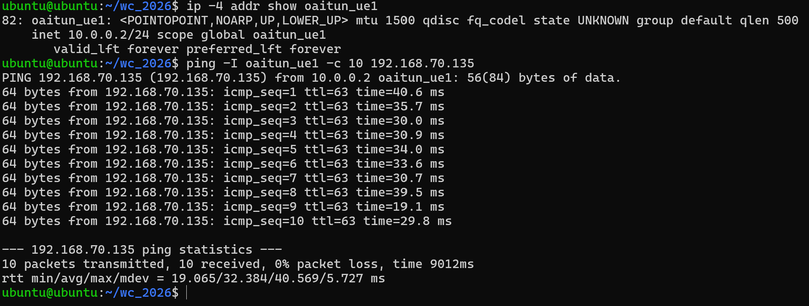

**Questions:**

1. **Why must Ping use the `oaitun_ue1` interface in this experiment?**
   The UE and the core run on the same host, and the host itself is attached to the CN5G Docker bridge (`oai-cn5g`, 192.168.70.129/26). A plain `ping 192.168.70.135` would therefore reach the External DN directly over the Docker bridge and bypass the 5G system entirely. `-I oaitun_ue1` binds the source address to the UE IP 10.0.0.2 and sends the packet into the OAI UE stack. The packet then crosses the full user-plane path: nrUE → RFsimulator → gNB → N3 GTP-U → UPF → N6 → External DN. Only then does the ping test the 5G network. The reply TTL of 63 (64 minus one hop) is consistent with the packet being routed once, by the UPF.

2. **Does successful Registration guarantee successful user-plane connectivity?**
   No. Registration only proves that the UE is authenticated and known to the AMF (control plane). User-plane connectivity additionally needs a successful PDU Session: a matching DNN/S-NSSAI, an IP address from the SMF, a working N4 session to the UPF, a GTP-U tunnel between the gNB and the UPF, a DRB on the radio side, the `oaitun_ue1` interface, and correct routing/NAT from the UPF to the DN. A failure in any of these leaves a registered UE that cannot send data.

3. **What does a successful Ping prove, and what does it not prove about the simulated 5G system?**
   It proves that the full user-plane chain works end to end: UE NAS/RRC/PDCP/RLC/MAC/PHY, the RFsimulator transport, the gNB stack, GTP-U on N3, UPF forwarding, and N6 routing to the DN and back. Here it also gave a baseline of 0 % loss and about 32 ms average RTT. It does not prove real radio performance: there is no real channel, fading, interference or RF impairments. It says nothing about achievable throughput, QoS enforcement, mobility/handover, multiple-UE scheduling, or the latency a commercial gNB and phone would achieve, because the timing here is dominated by software execution on a shared VM.

## 6. Task 4 — Investigate the Effect of Packet Size

All three scenarios were run back-to-back over the same established 5G connection: UE IP 10.0.0.2, gNB RNTI 5571, a single AMF registration from 02:35:29 until the UE deregistered at 02:58:35 (AMF clock).

```bash
ping -I oaitun_ue1 -s 56   -c 30 -i 0.2 192.168.70.135   # Scenario A
ping -I oaitun_ue1 -s 512  -c 30 -i 0.2 192.168.70.135   # Scenario B
ping -I oaitun_ue1 -s 1200 -c 30 -i 0.2 192.168.70.135   # Scenario C
```

Note: `-s` specifies ICMP payload size, not the complete IP packet size. The resulting IP packets are 84, 540 and 1228 bytes. All are below the 1500-byte MTU, also after adding GTP-U/UDP/IP encapsulation on N3, so no IP fragmentation occurs.

| Scenario | ICMP Payload | Avg. RTT (ms) | Max. RTT (ms) | Packet Loss (%) |
|---|---:|---:|---:|---:|
| A | 56 bytes | 28.609 | 35.787 | 0 |
| B | 512 bytes | 29.345 | 41.998 | 0 |
| C | 1200 bytes | 32.664 | 43.363 | 0 |

Additional values from the same runs:

| Scenario | IP packet | Min. RTT (ms) | mdev (ms) | Received |
|---|---:|---:|---:|---:|
| A | 84 B | 18.410 | 4.739 | 30/30 |
| B | 540 B | 17.798 | 5.396 | 30/30 |
| C | 1228 B | 20.780 | 5.142 | 30/30 |

| Scenario A | Scenario B | Scenario C |
|---|---|---|
| 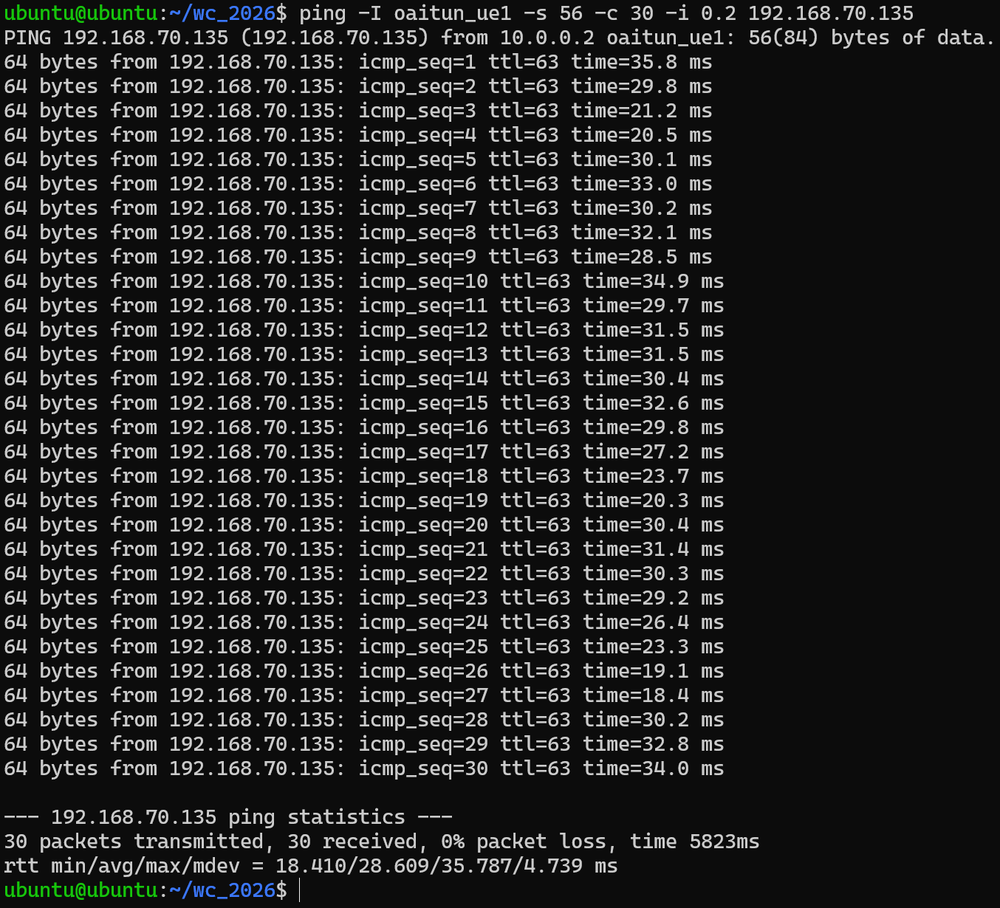 | 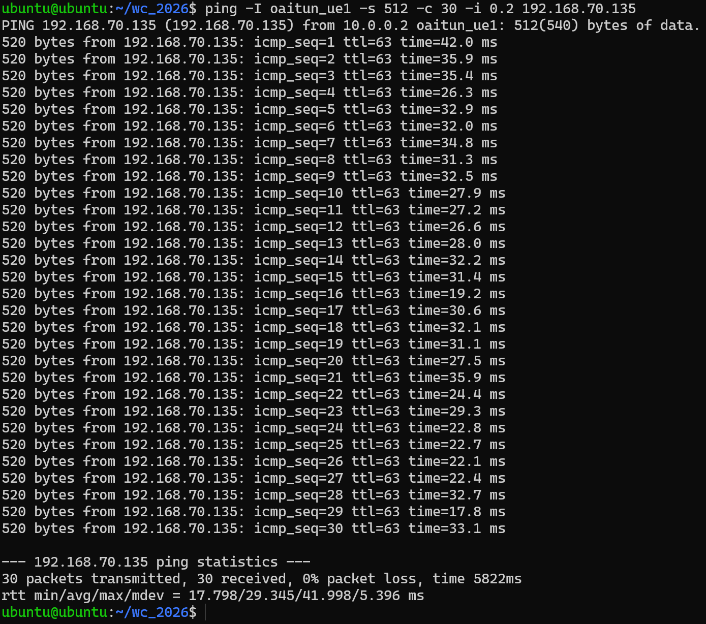 | 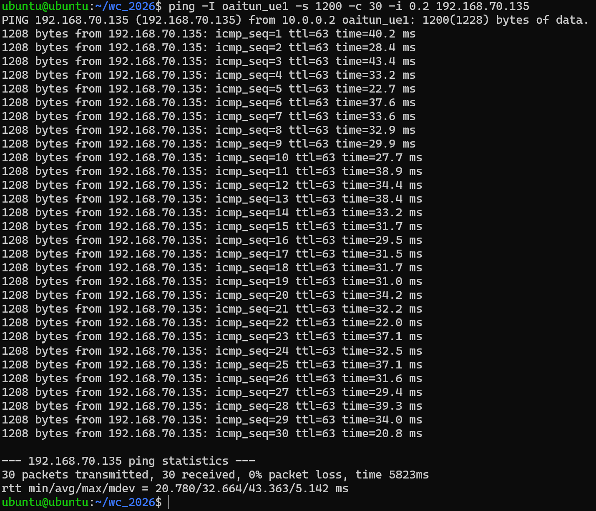 |

RTT difference:

```text
RTT Difference = Average RTT(C) - Average RTT(A)
               = 32.664 ms - 28.609 ms
               = 4.055 ms   (≈ +14.2 % relative to A)
```

For comparison, B − A = 29.345 − 28.609 = 0.736 ms.

**Questions:**

1. **Which scenario has the highest average RTT?**
   Scenario C (1200-byte payload) has the highest average RTT: 32.664 ms. It also has the highest maximum (43.363 ms) and the highest minimum (20.780 ms).

2. **Does increasing packet size always increase RTT in your measurements?**
   Not consistently. The averages increase from A to B to C, but the step from A to B is only 0.736 ms. That is much smaller than the per-packet spread (mdev ≈ 5 ms), and the standard error of the difference is about 1.3 ms, so it is not a meaningful change. Scenario B even has a *lower* minimum RTT (17.798 ms) than A (18.410 ms). Only the A to C difference (4.055 ms, about 3 standard errors) looks like a real effect of packet size. Run-to-run variation is also large: the same 56-byte ping gave averages of 32.384 ms (Task 3), 28.609 ms (Scenario A) and 25.950 ms (Task 5 recovery), a range of 6.4 ms. That range is bigger than the A to C difference. So larger packets tend to raise RTT slightly, but the effect is small compared with the system's own timing variability and is not guaranteed for every packet or every run.

3. **Why might a larger packet require more transmission or processing resources?**
   A larger IP packet produces a larger transport block. It needs more resource blocks or a higher MCS, more LDPC code blocks to encode and decode, and possibly more than one slot or HARQ transmission if the scheduler's grant is too small. At the RLC layer it may be segmented. In the uplink the UE must first request enough grant through a scheduling request and buffer status report. The UE log shows only 2 full UL slots per 5 ms TDD period, and the UE statistics show low-order modulation (about 2 bits/symbol) at code rate 0.1, so a 1228-byte packet can need more uplink resources than one grant provides. Every byte also costs CPU time in PDCP integrity, GTP-U encapsulation, and copying through the TUN device and Docker bridge. In RFsimulator every extra symbol also costs CPU time, because the PHY runs in software.

4. **What factors other than packet size could affect RTT in a software-based 5G network?**
   - The TDD pattern: the UE must wait for an UL slot, and there are only 2.x UL slots per 5 ms.
   - The SR/BSR/grant cycle and the `min_rxtxtime` (6 slots) between reception and transmission.
   - HARQ retransmissions.
   - CPU load and contention on the 8-vCPU VM: gNB, UE and 10 core containers share it, and the softmodems run real-time loops.
   - RFsimulator TCP buffering and socket scheduling.
   - The Linux scheduler, virtualization overhead and timer jitter.
   - Docker bridge networking and UPF processing.
   - Terminal logging by the softmodems.

   The 6.4 ms spread between identical 56-byte runs shows that these factors dominate.

5. **Can these results be interpreted as real over-the-air 5G latency? Explain.**
   No. The RTT here is measured on a simulated radio link with an ideal channel (SNR 51 dB, BLER 0), running on a general-purpose VM with no real-time guarantees. It mostly reflects how fast the host can execute the PHY/MAC processing and move IQ samples over TCP, not air-interface timing. A real deployment would add propagation, channel errors, interference, and HARQ retransmissions driven by real BLER, but would use dedicated, often hardware-accelerated, real-time platforms and tuned TDD/scheduling configurations. The absolute numbers (about 26–33 ms) and the packet-size effect therefore cannot be taken as real over-the-air 5G latency. They are only meaningful as a relative comparison within this setup.

## 7. Task 5 — Diagnose a Controlled UE Registration Failure

The original successful UE command (with `--uicc0.imsi 001010000000001`) was saved before starting. The CN5G subscriber database was not modified.

**Pre-check of the assumption.** The subscriber seed file `oai-cn5g/database/oai_db.sql` provisions only IMSIs `001010000000001` to `001010000000004`. `001010000000099` is therefore not provisioned in this environment.

### Step 1 & 2 — Launch the UE with an Incorrect IMSI

The nrUE was stopped with `Ctrl+C` (CN5G and gNB kept running) and relaunched with only the IMSI changed:

```bash
sudo ./nr-uesoftmodem \
  -r 106 \
  --numerology 1 \
  --band 78 \
  -C 3619200000 \
  --uicc0.imsi 001010000000099 \
  --rfsim \
  --rfsimulator.serveraddr 127.0.0.1
```

AMF and gNB evidence: [`logs/task5-amf-fail.log`](logs/task5-amf-fail.log), [`logs/task5-gnb-fail.log`](logs/task5-gnb-fail.log)

| Item | Observation |
|---|---|
| Modified parameter | `--uicc0.imsi`: `001010000000001` → `001010000000099` (nothing else changed) |
| UE synchronized with gNB? | **Yes.** UE: `Initial sync successful, PCI: 0`, `UE synchronized!`, `SIB1 decoded`; 4-step RA succeeded (`CBRA: Contention Resolution is successful`); gNB: `UE RNTI 3cd0 … in-sync` |
| RRC connection established? | **Yes.** UE: `Received NR_RRCSetup` → `State = NR_RRC_CONNECTED`; gNB: `(UE ID 3 RNTI 3cd0) Received RRCSetupComplete (RRC_CONNECTED reached)` |
| Registration successful? | **No.** AMF: `5GMM state transition: COMM-PROC-INIT -> 5GMM-DEREGISTERED (event: [REGISTRATION_REJECT_SENT])`; AMF UE table: `001010000000099 · 5GMM-DEREGISTERED`, GUTI empty; no PDU session, no `oaitun_ue1` |
| Error or rejection evidence | AMF → AUSF `POST /nausf-auth/v1/ue-authentications` (`supiOrSuci: imsi-001010000000099`) → **HTTP 404** `{"cause":"CONTEXT_NOT_FOUND","detail":"Resource corresponding to User imsi-001010000000099 not found"}` → `[error] Request Authentication Vectors failure` → Registration Reject `7e 00 44 03` (5GMM message type 0x44 = Registration Reject, 5GMM cause #3 "Illegal UE"). gNB relays it as `Send DL Information Transfer [4 bytes]`. UE: `Received NAS_DOWNLINK_DATA_IND type FGS_REGISTRATION_REJECT with length 4`, then `[NAS] Received Registration reject message too short` |
| Likely cause | The IMSI `001010000000099` has no subscription in the UDR. The AUSF/UDM cannot generate 5G-AKA authentication vectors, so the AMF rejects the registration before authentication even starts. |

**Reproducibility.** The wrong-IMSI UE was launched three times (AMF timestamps 03:00:33, 03:29:53 and 03:34:14). All three attempts ended the same way: AUSF 404, then `REGISTRATION_REJECT_SENT`. The screenshots and log excerpts below show the 03:34:14 attempt.

Note on the UE message `Registration reject message too short`: the 4-byte message (EPD, security header type, message type, 5GMM cause) is a complete minimal Registration Reject. The OAI v2.4.0 UE NAS decoder logs this warning while handling it, but the log line before it confirms that the UE did receive `FGS_REGISTRATION_REJECT`. The UE did not retry; it stayed RRC-connected without a NAS registration until it was stopped.

Failure seen at the UE:

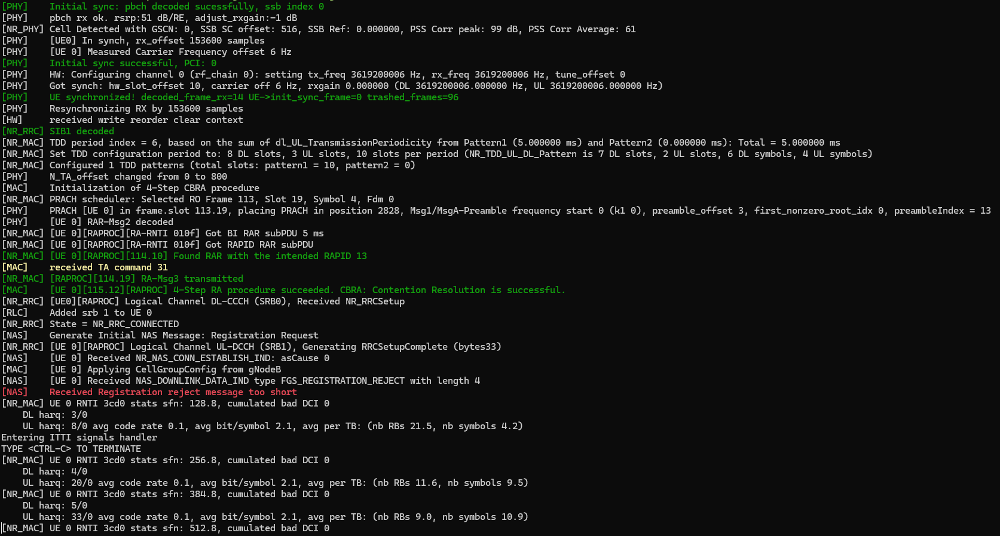

Failure seen at the AMF (`docker compose logs --since=2m oai-amf`):

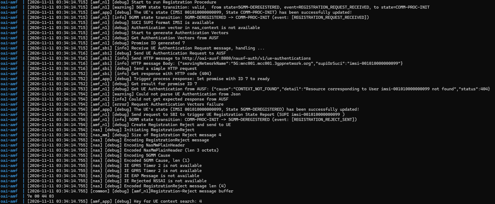

The gNB side ([`logs/task5-gnb-fail.log`](logs/task5-gnb-fail.log)) shows that the RAN part completed normally and only one 4-byte NAS message (the reject) was sent back:

```text
[NR_RRC] [DL] (cellID bc614e, UE ID 3 RNTI 3cd0) Send RRC Setup
[NR_RRC] [UL] (cellID bc614e, UE ID 3 RNTI 3cd0) Received RRCSetupComplete (RRC_CONNECTED reached)
[NR_RRC] [DL] (cellID bc614e, UE ID 3 RNTI 3cd0) Send DL Information Transfer [4 bytes]
```

### Step 3 — Restore the Original IMSI

The nrUE was restarted with `--uicc0.imsi 001010000000001` (all other parameters unchanged).

AMF and gNB evidence: [`logs/task5-amf-recovery.log`](logs/task5-amf-recovery.log), [`logs/task5-gnb-recovery.log`](logs/task5-gnb-recovery.log)

AMF, recovered registration:

```text
[03:50:49.337] 5GMM-DEREGISTERED -> COMM-PROC-INIT (event: [REGISTRATION_REQUEST_RECEIVED])
[03:50:49.337] HTTP message Body: {"servingNetworkName":"5G:mnc001.mcc001.3gppnetwork.org","supiOrSuci":"imsi-001010000000001"}
[03:50:49.512] Get response with HTTP code (201)                       <- AUSF found the subscriber
[03:50:49.514] COMM-PROC-INIT -> COMM-PROC-INIT (event: [AUTHENTICATION_REQUEST_SENT])
[03:50:49.559] COMM-PROC-INIT -> COMM-PROC-INIT (event: [AUTHENTICATION_RESPONSE_RECEIVED])
[03:50:49.625] COMM-PROC-INIT -> COMM-PROC-INIT (event: [SECURITY_MODE_COMMAND_SENT])
[03:50:49.654] COMM-PROC-INIT -> COMM-PROC-INIT (event: [SECURITY_MODE_COMPLETE_RECEIVED])
[03:50:49.682] COMM-PROC-INIT -> COMM-PROC-INIT (event: [REGISTRATION_ACCEPT_SENT_WITH_T3550])
[03:50:49.786] COMM-PROC-INIT -> 5GMM-REGISTERED (event: [REGISTRATION_COMPLETE_RECEIVED])
[03:50:49.796] Handle PDU Session Establishment Request (SUPI imsi-001010000000001, PDU Session ID 10)

|  Index |     5GMM State     |   IMSI/SUPI     |        GUTI        |
|    1   |   5GMM-REGISTERED  | 001010000000001 |00101010041345523618|
|    2   |  5GMM-DEREGISTERED | 001010000000099 |                    |
```

Comparison of the failed and recovered attempts (same gNB, same CN5G, only the IMSI changed):

| Check point | Wrong IMSI `…099` | Restored IMSI `…001` |
|---|---|---|
| Cell sync / RA / RRC | ✅ RNTI 3cd0, `RRC_CONNECTED reached` | ✅ RNTI 1164, `RRC_CONNECTED reached` |
| AUSF authentication | ❌ HTTP 404 `CONTEXT_NOT_FOUND` | ✅ HTTP 201, 5G-AKA completed |
| NAS security mode | — (never reached) | ✅ `SECURITY_MODE_COMPLETE_RECEIVED` |
| Registration result | ❌ `REGISTRATION_REJECT_SENT` (cause #3) | ✅ Registration Accept, `5GMM-REGISTERED`, 5G-TMSI 3455236182 |
| PDU Session / DRB | ❌ none | ✅ PDU Session 10, DRB 1, TEID `0x6ad5a6bd` |
| UE IP / tunnel | ❌ no `oaitun_ue1` | ✅ `oaitun_ue1` 10.0.0.2 |
| Ping to 192.168.70.135 | ❌ not possible | ✅ 10/10 received, 0 % loss, RTT min/avg/max = 15.257/25.950/37.060 ms |

Recovered UE:

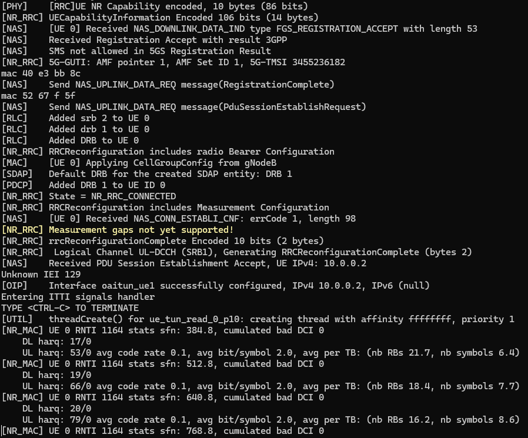

Recovered connectivity:

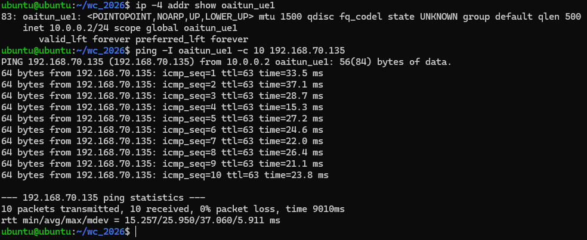

**Questions:**

1. **Why can the UE potentially synchronize with the gNB even when the IMSI is incorrect?**
   Synchronization uses only broadcast, cell-level signals: PSS/SSS for timing and the physical cell ID, PBCH/MIB and SIB1 for system information. These are the same for every UE and contain no subscriber identity. Random access and RRC setup are also handled by the gNB without checking the subscription. The IMSI (sent as a SUCI) is first used in the NAS Registration Request, which the gNB just relays to the AMF. This is exactly what was observed: the wrong-IMSI UE reached `Initial sync successful`, `CBRA: Contention Resolution is successful`, and `NR_RRC_CONNECTED` before being rejected.

2. **Which network function is involved in UE authentication?**
   The AUSF performs the 5G-AKA authentication on request from the AMF (acting as SEAF). The UDM (with its ARPF function) generates the authentication vectors, de-conceals the SUCI to the SUPI, and fetches the subscriber's credentials and subscription data from the UDR (backed by MySQL here). The AMF then verifies the UE response and runs NAS Security Mode Command. In the failure log, the AMF's request to `http://oai-ausf:8080/nausf-auth/v1/ue-authentications` returned 404 because the AUSF/UDM/UDR chain had no record for `imsi-001010000000099`.

3. **Why does changing an IMSI affect Registration but not the RFsimulator TCP connection itself?**
   The RFsimulator TCP connection is just the transport for IQ samples, below the physical layer. It is opened as soon as the nrUE process starts and connects to `127.0.0.1:4043`, and it knows nothing about protocols or identities. The IMSI is only read by the NAS layer at the very top of the UE stack, and is checked only by the core (AMF/AUSF/UDM/UDR). A wrong IMSI therefore changes the NAS outcome but not the TCP link, the radio synchronization, or the RRC connection. All of these succeeded for both the wrong and the correct IMSI.

4. **What evidence proves that restoring the correct configuration solved the problem?**
   With only the IMSI changed back, every stage that had failed now succeeds:
   - The AUSF answers HTTP 201 instead of 404, and 5G-AKA and NAS security mode complete.
   - The AMF moves the UE to `5GMM-REGISTERED` and assigns a GUTI (`00101010041345523618`). The UE logs `Received Registration Accept`.
   - PDU Session 10 and DRB 1 are set up. The UE receives `PDU Session Establishment Accept, UE IPv4: 10.0.0.2` and configures `oaitun_ue1`.
   - `ping -I oaitun_ue1 -c 10 192.168.70.135` returns 10/10 with 0 % loss.

   Because the gNB, the core and every other UE parameter stayed the same, the IMSI is shown to be the sole cause of the failure.

## 8. Task 7 — Explain the Relationship Between Simulation and Real 5G

| Feature | OAI RFsimulator | Physical 5G System |
|---|---|---|
| gNB and UE protocol stack | Full stack in software (PHY, MAC, RLC, PDCP, SDAP, RRC, NAS), the same code as with an SDR | Full stack, often split into CU/DU/RU, with commercial UE chipsets |
| OFDM signal processing | Performed in software (IFFT/FFT, CP, channel coding, modulation); IQ samples are produced and consumed | Performed in baseband hardware/software, then converted to analog RF |
| Physical antennas | None; IQ samples sent over TCP (port 4043) | Real antennas, possibly MIMO/beamforming arrays |
| RF hardware impairments | None by default (no phase noise, CFO, IQ imbalance, PA non-linearity, ADC quantization); observed CFO only 6 Hz | Present and must be compensated |
| Wireless propagation effects | Ideal channel by default (observed SNR 51 dB, BLER 0); an optional channel model can emulate noise/fading | Path loss, multipath fading, Doppler, shadowing, interference |
| 5G Core connectivity | Real NGAP/N2 and GTP-U/N3 to OAI CN5G (Docker) | Real NGAP/N2 and GTP-U/N3 to a commercial or open-source 5GC |

**Questions:**

1. **Which parts of the 5G system remain functional when physical RF hardware is replaced with RFsimulator?**
   Everything except the analog radio and the real channel stays functional, as this lab showed:
   - the full baseband PHY: synchronization, OFDM, channel coding, HARQ;
   - MAC scheduling, RLC, PDCP and SDAP;
   - RRC and NAS signaling, including authentication and rejection;
   - NGAP on N2 and GTP-U on N3;
   - all core network functions (AMF, SMF, UPF, AUSF, UDM, UDR, NRF);
   - the end-to-end PDU session and the user-plane path to the DN.

2. **Why is RFsimulator useful for testing the 5G protocol stack?**
   It needs no SDR hardware, RF license or shielded room. Experiments are repeatable and deterministic, with no channel randomness. It can run on a laptop, VM or CI server, and several UEs can attach to one gNB. Protocol and configuration problems, such as registration, PDU session setup, or core integration, can be isolated from radio problems and debugged quickly with full logs on both sides. Task 5 is an example: the failure could be traced from the UE through the gNB to the AMF and AUSF in a few minutes.

3. **Why might latency and throughput differ between RFsimulator and a real 5G deployment?**
   In RFsimulator, the limit is CPU speed and the TCP sample transport. The softmodems may not process every slot in real time on a shared VM, which adds variable delay or slows the simulated clock. TCP buffering adds its own jitter. On the other hand, an ideal channel means no decoding errors and no HARQ retransmissions. A real system runs on dedicated, often hardware-accelerated, real-time platforms. Its performance is set by bandwidth, MCS, MIMO layers, channel quality, interference and the scheduler. Both latency and throughput can therefore be higher or lower than in simulation.

4. **What would need to change if you wanted to test a physical UE instead of OAI nrUE?**
   - Replace `--rfsim` with a real SDR front end (for example a USRP B210, matching the `usrpb210` config) with antennas and a precise clock source, in a shielded or licensed environment.
   - Make sure the gNB can meet real-time deadlines: a low-latency kernel and CPU tuning.
   - Program a SIM card with the IMSI, K and OPc that match the CN5G subscriber database.
   - Configure the phone with the right band, PLMN (001/01), APN/DNN and slice.
   - Verify that the band, numerology and bandwidth match what the commercial UE supports.

## 9. Final Analysis

1. **Describe the complete process from starting the OAI 5GC to successful user-plane connectivity.**
   `docker compose up -d` started MySQL and the NRF first; the AMF, SMF, UPF, AUSF, UDM and UDR then registered with the NRF, and all 10 containers became healthy. `nr-softmodem` opened an SCTP association to the AMF and completed NG Setup (`Received NGSetupResponse from AMF`), then waited for an RFsimulator client on TCP port 4043. `nr-uesoftmodem` connected to that port, detected PSS/SSS (`Initial sync successful, PCI: 0`), decoded SIB1, completed 4-step random access, and reached `NR_RRC_CONNECTED`. Its NAS Registration Request triggered 5G-AKA via AMF–AUSF–UDM–UDR, NAS security mode and Registration Accept. Finally, PDU Session 10 was established: the SMF assigned 10.0.0.2 and programmed the UPF, the gNB set up DRB 1 and the N3 GTP-U tunnel, the UE created `oaitun_ue1`, and `ping -I oaitun_ue1 192.168.70.135` succeeded with 0 % loss.

2. **Explain the difference between an RFsimulator TCP connection and a 5G PDU Session.**
   The RFsimulator TCP connection (`127.0.0.1:54014 ⇄ :4043`) is a test-environment substitute for the radio channel: a socket between the nrUE and gNB processes that carries raw IQ samples and knows nothing about 5G identities or IP traffic. A PDU Session is a 5G logical connection between the UE and a data network, negotiated through NAS with the AMF/SMF, with a DNN, S-NSSAI, QoS flows and an assigned UE IP address (10.0.0.2). It is realized by a DRB on the radio side plus a GTP-U tunnel between the gNB and the UPF, and its packets are carried *inside* the radio waveform that the TCP connection transports. Task 5 shows that the two are independent: with the wrong IMSI the TCP connection and RRC were up, but no PDU Session existed. In short, one is a physical-layer transport, while the other is an end-to-end user-plane service.

3. **Based on your measurements, how did packet size affect RTT and packet loss?**
   Packet loss was 0 % in all three scenarios (30/30 each), so packet size up to a 1228-byte IP packet had no effect on loss. The average RTT rose from 28.609 ms (56 B) to 29.345 ms (512 B) to 32.664 ms (1200 B), so the 1200-byte packets were about 4.06 ms (14 %) slower than the 56-byte ones. However, the A to B step (0.74 ms) is well within the noise (mdev ≈ 5 ms), and B even had a lower minimum RTT than A. Repeated 56-byte runs varied between 25.95 and 32.38 ms. The data therefore show only a modest increase for the largest packets, plausibly from extra uplink resources and processing per packet, on top of a much larger baseline set by TDD timing and software scheduling.

4. **Describe the registration failure you introduced and explain how you diagnosed and recovered from it.**
   I restarted the nrUE with only `--uicc0.imsi` changed from `001010000000001` to the unprovisioned `001010000000099`. The UE still synchronized, completed random access and reached `NR_RRC_CONNECTED`, which ruled out a radio or RFsimulator problem, but it then logged `FGS_REGISTRATION_REJECT` and never got an IP address. In the AMF log, the AUSF answered the authentication request with HTTP 404 `CONTEXT_NOT_FOUND … imsi-001010000000099 not found`, followed by `Request Authentication Vectors failure` and `REGISTRATION_REJECT_SENT` (cause #3, Illegal UE). This identified a missing subscriber record, consistent with the database containing only IMSIs …001–…004, and the same rejection occurred in all three wrong-IMSI attempts. Restarting the UE with the original IMSI led to HTTP 201 from the AUSF, a completed 5G-AKA and security mode, `5GMM-REGISTERED`, PDU Session 10 with IP 10.0.0.2, and a 10/10 successful ping, confirming the fix.

5. **Identify two limitations of this simulated environment and explain how they might affect experimental results.**
   First, the radio channel is ideal: there is no fading, noise, interference or RF impairments. The gNB reported SNR 51 dB and BLER 0, so decoding never fails, HARQ retransmissions and link adaptation are barely exercised, and the measured loss (0 % everywhere) and RTT are more optimistic and stable than over the air. Second, everything (gNB, UE, and ten core containers) runs on one 8-vCPU / 8 GB VM without real-time guarantees, so measured RTT is dominated by CPU scheduling, virtualization jitter and RFsimulator TCP buffering rather than 5G slot timing. This is visible in the 6.4 ms spread between identical 56-byte runs, which is larger than the packet-size effect itself. Results can therefore change with host load and cannot be generalized to real gNB hardware or to throughput at scale.

## 10. Submission Checklist

- [x] Completed 5G SA connection verification table.
- [x] gNB and nrUE connection screenshots.
- [x] RFsimulator TCP connection evidence.
- [x] Baseline Ping measurement.
- [x] Three packet-size comparison results.
- [x] RTT difference calculation.
- [x] Controlled failure and recovery evidence.
- [x] RFsimulator versus physical 5G comparison.
- [x] Answers to the final analysis questions.

All measurements and log evidence come from my own experimental environment.
