# Lab 4 — 5G CU/DU Split Deployment and F1-C/F1-U Analysis

**Student handout**  
**Environment:** Ubuntu 24.04 LTS · OpenAirInterface (OAI) v2.4.0 · RFsimulator · no SDR required  
**Prerequisite:** Lab 3 completed successfully (OAI CN5G, gNB, nrUE, UE tunnel and Ping)

> **Lab objective:** Replace the monolithic gNB from Lab 3 with a split gNB-CU and gNB-DU. Capture and analyze both **F1-C** (F1AP over SCTP) and **F1-U** (GTP-U over UDP) in a single PCAP file. Verify that the UE can still establish a PDU session and reach the external data network.
>
> **Instructor validation:** This lab's CU/DU split, F1 Setup, UE RRC signaling, UE Context procedures, GTP-U T-PDUs, and external-DN Ping were observed on the classroom OAI v2.4.0 environment. Exact IP addresses, frequencies and core network configuration must be checked on each student image.

---

## 1. Learning objectives

After completing this lab, you should be able to:

1. Explain the functional division between gNB-CU and gNB-DU.
2. Deploy a split 5G SA RAN with OAI and RFsimulator.
3. Identify **F1-C** control-plane messages (F1 Setup, RRC transfer, UE Context Setup).
4. Identify **F1-U** user-plane GTP-U packets, including their direction and TEID.
5. Verify UE IP connectivity through the split architecture.
6. Distinguish F1-U from the separate **N3** interface, even though both can use GTP-U.

## 2. Network architecture and experimental parameters

```text
                         OAI 5G Core
                     AMF / SMF / UPF
                           |
                   N2 (NGAP) / N3 (GTP-U)
                           |
                      +----------+
                      |  gNB-CU  |  F1-C IP: 127.0.0.3
                      | RRC/PDCP |  (example classroom setup)
                      +----------+
                         |     |
        F1-C: F1AP/SCTP |     | F1-U: GTP-U/UDP
                         |     |
                      +----------+
                      |  gNB-DU  |  F1 IP: 127.0.0.4
                      |RLC/MAC/PHY|
                      +----------+
                           |
                    RFsimulator (IQ/TCP)
                           |
                         nrUE
                           |
                      oaitun_ue1
                           |
                       ICMP Ping
```

| Parameter | Classroom configuration | **Observed in my environment** |
|---|---|---|
| OAI version | `v2.4.0` | `v2.4.0` (`git describe --tags`) |
| RAN | One gNB-CU + one gNB-DU + one nrUE | One gNB-CU (`cu-rfsim`) + one gNB-DU (`du-rfsim`) + one nrUE |
| Radio | RFsimulator, no physical SDR | RFsimulator (TCP 4043), no SDR |
| NR band | n78 | n78 |
| Bandwidth | 106 PRBs | 106 PRBs |
| Numerology | 1 (30 kHz SCS) | 1 (30 kHz SCS) |
| CU F1 address (observed) | `127.0.0.3` | `127.0.0.3` |
| DU F1 address (observed) | `127.0.0.4` | `127.0.0.4` |
| DU SSB NR-ARFCN (observed) | `630048` (3,450.72 MHz) | `630048`; DU log: `corresponds to 3450720000 Hz` |
| UE frequency argument used in successful split test | `-C 3450720000` | `-C 3450720000` |
| UE IMSI | `001010000000001` | `001010000000001` |
| External DN | `192.168.70.135` | `192.168.70.135` |

**Important:** The Lab 3 monolithic gNB config used `absoluteFrequencySSB = 641280` (3,619.20 MHz), whereas the split DU config used `630048` (3,450.72 MHz). The frequency parameters **must match the working DU/UE pair**. Do not reuse Lab 3's `-C 3619200000` without checking the DU configuration. The `-C` argument and effective radio carrier placement should be verified against OAI startup logs; the above value is the one used in the successful classroom test, not a general formula for every DU file.

**My environment:**
- **Host:** the same VM as Lab 3, running Ubuntu **22.04.5** LTS (kernel 5.15) instead of 24.04, on a Xeon Silver 4110 with 8 vCPU and 8 GB RAM.
- **Core network:** OAI CN5G with 10 containers. The AMF is `192.168.70.132`, the UPF is `192.168.70.134`, and the CU's N2/N3 address is `192.168.70.129`, all on the Docker bridge `oai-cn5g`.
- **Paths:** the OAI tree and CN5G are installed under `~/wc_2026/` instead of `~/`. Otherwise every command below is the handout's, with `| tee` added to some of them to save their output as logs.

**Submitted files:**
- [`lab4-f1-complete.pcap`](lab4-f1-complete.pcap): the required PCAP.
- [`lab4-n3.pcap`](lab4-n3.pcap): an extra N3 capture, used for the F1-U vs N3 comparison.
- [`images/`](images/): screenshots.
- [`logs/`](logs/): CU/DU/UE logs with ANSI colour codes removed, ping output, `docker compose ps`, and `tshark` summaries.

---

## 3. Task 1 — Inspect the split configurations

### Step 1. Confirm the configuration files exist

```bash
cd ~/wc_2026/openairinterface5g-v2.4.0

ls -l \
  targets/PROJECTS/GENERIC-NR-5GC/CONF/gnb-cu.sa.f1.conf \
  targets/PROJECTS/GENERIC-NR-5GC/CONF/gnb-du.sa.band78.106prb.rfsim.pci0.conf
```

### Step 2. Check frequency and F1 network settings

```bash
grep -nE \
'absoluteFrequencySSB|dl_absoluteFrequencyPointA|dl_carrierBandwidth|physCellId|min_rxtxtime|local_s_address|remote_s_address|local_n_address|remote_n_address|local_s_portd|remote_s_portd|local_n_portd|remote_n_portd|amf_ip_address' \
  targets/PROJECTS/GENERIC-NR-5GC/CONF/gnb-cu.sa.f1.conf \
  targets/PROJECTS/GENERIC-NR-5GC/CONF/gnb-du.sa.band78.106prb.rfsim.pci0.conf
```

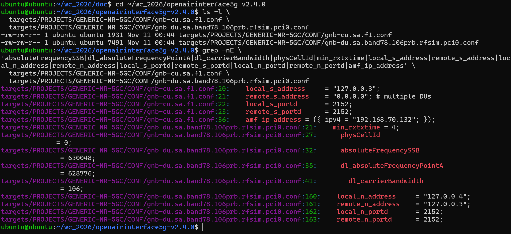

Raw output: [`logs/task1-config-grep.txt`](logs/task1-config-grep.txt)

**Record:** The CU and DU F1 addresses, the DU SSB frequency, and PRB count. If the local settings differ from the table above, adapt the following commands and capture filters accordingly.

| Item | CU (`gnb-cu.sa.f1.conf`) | DU (`gnb-du.sa.band78.106prb.rfsim.pci0.conf`) |
|---|---|---|
| F1 local / remote address | `127.0.0.3` / `0.0.0.0` (accepts any DU) | `127.0.0.4` / `127.0.0.3` |
| F1-U port (local / remote) | 2152 / 2152 | 2152 / 2152 |
| DU SSB frequency | — (the CU has no radio) | `absoluteFrequencySSB = 630048` (3,450.72 MHz) |
| Point A / PRB count / PCI | — | `628776` / **106** / `0` (`min_rxtxtime = 4`) |
| Core network | `amf_ip_address = 192.168.70.132` | — |

The local settings match the table above, so the following commands and capture filters were used unchanged.

**Questions**

1. **Which protocol layers mainly reside in the CU, and which reside in the DU?**
   The CU holds **RRC, SDAP and PDCP**. RRC together with the PDCP for signalling bearers forms CU-CP, and SDAP together with the PDCP for data bearers forms CU-UP. The CU also terminates NGAP (N2) and GTP-U (N3) toward the 5GC. The DU holds the timing-critical **RLC, MAC (scheduler, HARQ) and PHY**, plus the RF/RFsimulator side. My logs confirm this split. The CU reports `RC.nb_nr_macrlc_inst = 0, RC.nb_nr_L1_inst = 0, RC.nb_RU = 0`, while the DU reports `= 1, = 1, = 1` (line 5 of [`task2-cu.log`](logs/task2-cu.log) and [`task2-du.log`](logs/task2-du.log)). In this OAI build, CU-CP and CU-UP run in a single process, so the E1 interface between them is internal.

2. **What is the purpose of the F1 interface?**
   F1 (TS 38.470–38.475) connects the gNB-CU to its gNB-DUs, so that the two together appear as one gNB to the UE and to the 5GC. **F1-C** (F1AP over SCTP) handles interface management (F1 Setup, configuration update), UE context management and RRC message transfer. **F1-U** (GTP-U over UDP, with the NR-U header when needed) carries each DRB's PDCP PDUs, along with flow-control and delivery-status information. This lets one centralized CU serve several DUs deployed close to the antennas.

3. **Why must the UE radio frequency be compatible with the DU rather than taken blindly from the previous lab?**
   The DU owns the PHY and the cell's radio configuration (SSB, Point A, bandwidth, TDD), so the UE must search where *this* DU transmits. The DU uses ARFCN 630048 (3,450.72 MHz), but Lab 3's gNB used 641280 (3,619.2 MHz), which is 168.48 MHz away. RFsimulator delivers the IQ samples over TCP regardless of the carrier, but the UE derives the carrier, SSB position and frame parameters from `-C`, so a wrong value does not match the DU's signal. The handout reports that `-C 3619200000` failed with this DU. With `-C 3450720000`, my UE logged `Initial sync successful, PCI: 0`, a carrier offset of only `-7 Hz`, and `SIB1 decoded` ([`task2-ue.log`](logs/task2-ue.log) lines 78–84).

---

## 4. Task 2 — Deploy the split 5G SA network

Before starting, stop the monolithic Lab 3 gNB and any old nrUE processes with `Ctrl+C`. Avoid running two gNB/DU RFsimulator servers on the same listening port.

### Terminal 1 — Start CN5G

```bash
cd ~/wc_2026/oai-cn5g
docker compose up -d
docker compose ps
```

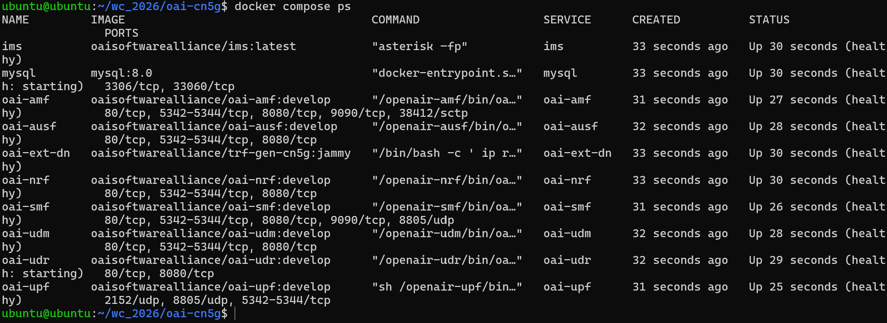

The screenshot was taken about 30 s after start. At that point `mysql` and `oai-udr` were still `(health: starting)`, while the other 8 containers, including `oai-amf`, were already healthy. The same command run later, while the UE was connected, showed all 10 containers `Up 26 minutes (healthy)` ([`logs/task2-cn5g-ps.txt`](logs/task2-cn5g-ps.txt)).

### Terminal 2 — Start gNB-CU

```bash
cd ~/wc_2026/openairinterface5g-v2.4.0/cmake_targets/ran_build/build

sudo ./nr-softmodem \
  -O ../../../targets/PROJECTS/GENERIC-NR-5GC/CONF/gnb-cu.sa.f1.conf \
  2>&1 | tee ~/wc_2026/doc/lab4/logs/task2-cu.log
```

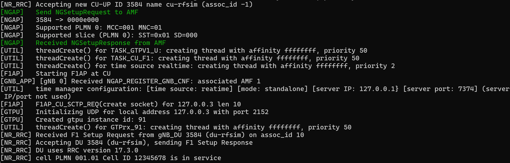

### Terminal 3 — Start gNB-DU

**Start the packet capture in Task 3 *before* starting the DU if you want to record the initial F1 Setup handshake.**

```bash
cd ~/wc_2026/openairinterface5g-v2.4.0/cmake_targets/ran_build/build

sudo ./nr-softmodem \
  -O ../../../targets/PROJECTS/GENERIC-NR-5GC/CONF/gnb-du.sa.band78.106prb.rfsim.pci0.conf \
  --rfsim \
  2>&1 | tee ~/wc_2026/doc/lab4/logs/task2-du.log
```

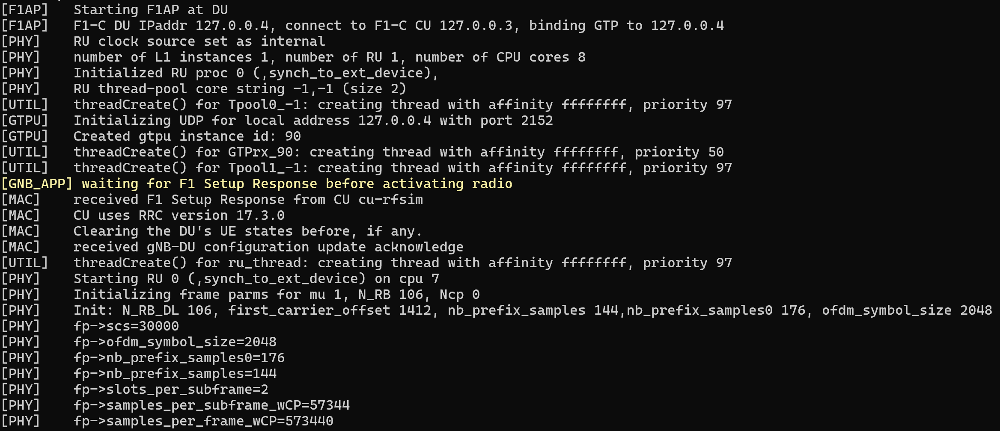

### Terminal 4 — Start nrUE

```bash
cd ~/wc_2026/openairinterface5g-v2.4.0/cmake_targets/ran_build/build

sudo ./nr-uesoftmodem \
  -r 106 \
  --numerology 1 \
  --band 78 \
  -C 3450720000 \
  --uicc0.imsi 001010000000001 \
  --rfsim \
  --rfsimulator.serveraddr 127.0.0.1 \
  2>&1 | tee ~/wc_2026/doc/lab4/logs/task2-ue.log
```

> **Instructor note:** This UE command reflects the working classroom split configuration. In particular, the original Lab 3 `-C 3619200000` setting was not compatible with this DU configuration. If a provided classroom image has different NR frequencies or UICC credentials, use the instructor-validated values.

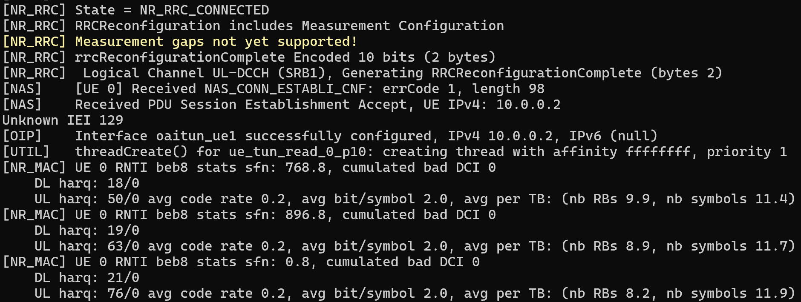

Key log lines (cited by line number later in the report):

```text
# gNB-CU (logs/task2-cu.log)
30: [NGAP]   Received NGSetupResponse from AMF
42: [NR_RRC] Accepting DU 3584 (du-rfsim), sending F1 Setup Response
44: [NR_RRC] cell PLMN 001.01 Cell ID 12345678 is in service
49: [NR_RRC] [UL] (cellID bc614e, UE ID 1 RNTI beb8) Received RRCSetupComplete (RRC_CONNECTED reached)
78: [GTPU]   [89] UE ID 1: Create tunnel TEID incoming 0x401e9cc6 outgoing 0x1 to remote IPv4 192.168.70.134   <- N3
87: [GTPU]   [91] UE ID 1: Update tunnel TEID incoming 0xc9b334f7 outgoing 0x475d7714 to remote IPv4 127.0.0.4 <- F1-U
# gNB-DU (logs/task2-du.log)
 64: [F1AP]   F1-C DU IPaddr 127.0.0.4, connect to F1-C CU 127.0.0.3, binding GTP to 127.0.0.4
 74: [GNB_APP] waiting for F1 Setup Response before activating radio
 75: [MAC]    received F1 Setup Response from CU cu-rfsim
427: [NR_MAC] 520.17 UE beb8: Received Ack of Msg4. CBRA procedure succeeded (UE Connected)
439: [GTPU]   [90] UE ID 48824: Create tunnel TEID incoming 0x475d7714 outgoing 0xc9b334f7 to remote IPv4 127.0.0.3
# nrUE (logs/task2-ue.log)
 84: [NR_RRC] SIB1 decoded
159: [NAS]    Received Registration Accept with result 3GPP
182: [OIP]    Interface oaitun_ue1 successfully configured, IPv4 10.0.0.2, IPv6 (null)
```

### Check the UE connection

```bash
ip -4 addr show oaitun_ue1
ping -I oaitun_ue1 -c 10 192.168.70.135 | tee ~/wc_2026/doc/lab4/logs/task2-ping.txt
```

**Evidence:** Screenshots of CU/DU startup, UE connection, and successful Ping. Record the observed UE IP, transmitted/received packets, packet loss, and average RTT. Do **not** invent values; they vary by machine.

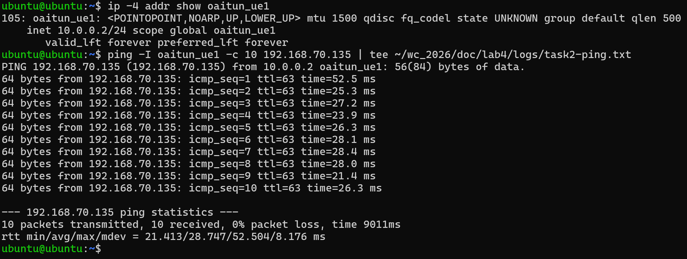

| Measurement | Observed Value |
|---|---|
| UE IP (`oaitun_ue1`) | **10.0.0.2** |
| Transmitted / received packets | 10 / 10 |
| Packet loss | **0 %** |
| Average RTT | **28.747 ms** (min 21.413 / max 52.504 / mdev 8.176 ms; the maximum is the first packet) |

---

## 5. Task 3 — Capture F1-C and F1-U in a single PCAP

The classroom capture showed CU `127.0.0.3` and DU `127.0.0.4` on the Linux loopback interface (`lo`).

### Step 1. Start packet capture

Start CN5G and CU, but **before starting the DU** open another terminal:

```bash
sudo tcpdump -i lo -s 0 -nn \
  -w ~/lab4-f1-complete.pcap \
  'host 127.0.0.3 and host 127.0.0.4 and (sctp or udp port 2152)'
```

This captures:

- **F1-C:** F1AP carried over SCTP.
- **F1-U:** GTP-U carried over UDP port 2152, **provided the configured F1-U endpoints and port match these values**.

To compare F1-U with N3 in Task 5, I ran a second capture at the same time on the CN5G bridge. This capture is not part of the handout:

```bash
sudo tcpdump -i oai-cn5g -s 0 -nn -w ~/lab4-n3.pcap 'udp port 2152'
```

### Step 2. Trigger control-plane and user-plane traffic

1. Start the DU to trigger **SCTP association** and **F1 Setup**.
2. Start nrUE to trigger **RRC** and **UE Context** procedures.
3. After the UE tunnel appears, generate traffic:

```bash
ping -I oaitun_ue1 -c 30 -i 0.2 192.168.70.135 | tee ~/wc_2026/doc/lab4/logs/task3-ping.txt
```

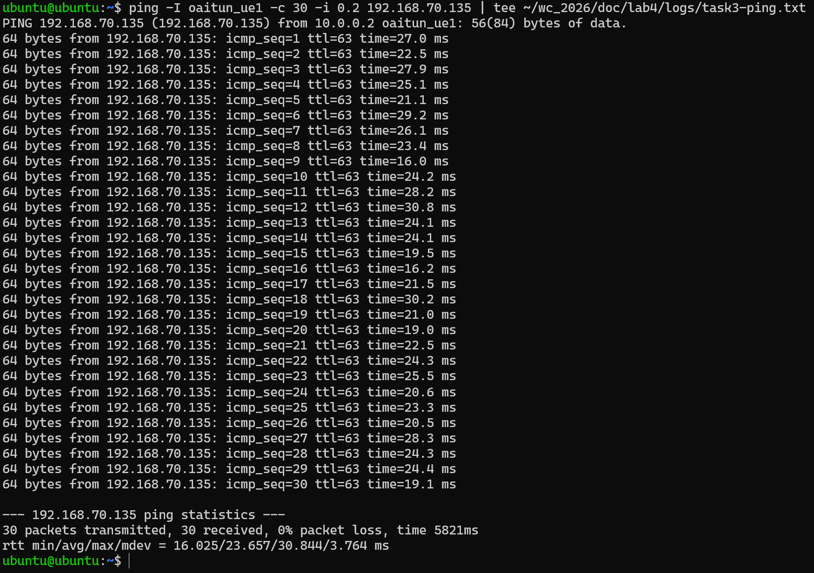

Result: 30 transmitted, 30 received, **0 % loss**, RTT min/avg/max/mdev = 16.025 / **23.657** / 30.844 / 3.764 ms. The 10-packet Ping from Task 2 was also run while this capture was active.

4. Press `Ctrl+C` in the **tcpdump terminal** to finish and save the PCAP.
5. Verify the file:

```bash
ls -lh ~/lab4-f1-complete.pcap
```

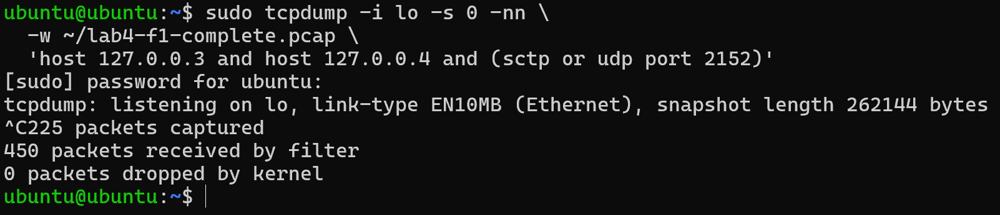

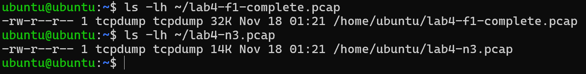

| PCAP | Interface | Packets | Content (`tshark -z io,phs`) |
|---|---|---:|---|
| [`lab4-f1-complete.pcap`](lab4-f1-complete.pcap) (32 K) | `lo` | 225 | 138 SCTP (24 frames carrying **F1AP**) + 87 **GTP-U** |
| [`lab4-n3.pcap`](lab4-n3.pcap) (14 K) | `oai-cn5g` | 87 | 87 GTP-U (inside: 80 ICMP + 7 ICMPv6) |

### Alternative: capture all traffic between CU and DU

If you are unsure of the F1-U UDP port, use this **instead of** the filtered capture above:

```bash
sudo tcpdump -i lo -s 0 -nn \
  -w ~/lab4-f1-all.pcap \
  'host 127.0.0.3 and host 127.0.0.4'
```

If the CU and DU are not communicating over `lo`, select the correct interface (`ip -br addr` or `tcpdump -D`) and update the IP filter.

*Not needed: the configured F1-U endpoints and port matched, so the filtered capture already contains both F1-C and F1-U.*

---

## 6. Task 4 — Analyze F1-C (F1AP / SCTP)

Open the capture:

```bash
wireshark ~/lab4-f1-complete.pcap
```

*The VM has no desktop, so I opened the same file in Wireshark on my laptop. I cross-checked the packet numbers with `tshark` ([`logs/task4-f1ap-list.txt`](logs/task4-f1ap-list.txt)).*

Useful **Wireshark display filters**:

```text
sctp
f1ap
```

Find and record these messages:

| Message | Typical direction | Meaning | **Observed (packet #, src → dst, time UTC)** |
|---|---|---|---|
| SCTP INIT / INIT_ACK / COOKIE_ECHO / COOKIE_ACK | DU ↔ CU | Establish SCTP association | **#1–#4**, DU 127.0.0.4:42604 ↔ CU 127.0.0.3:38472, 01:07:18.909, 0.47 ms in total |
| F1 Setup Request | DU → CU | DU initiates F1 connection and provides served-cell information | **#5** 127.0.0.4 → 127.0.0.3, 01:07:19.0067 (DU ID 3584, `du-rfsim`, NR-CGI 12345678, PCI 0, TAC 1, MIB/SIB1) |
| F1 Setup Response | CU → DU | CU accepts F1 Setup | **#7** 127.0.0.3 → 127.0.0.4, 01:07:19.0091 (+2.4 ms) |
| GNBDUConfigurationUpdate | DU → CU | DU informs CU of configuration changes | **#9** 127.0.0.4 → 127.0.0.3; Acknowledge **#10** 127.0.0.3 → 127.0.0.4 |
| Initial UL RRC Message Transfer (RRC Setup Request) | DU → CU | UE initial RRC request forwarded to CU | **#64** 127.0.0.4 → 127.0.0.3, 01:14:38.690 (C-RNTI 48824 = 0xbeb8) |
| DL RRC Message Transfer (RRC Setup) | CU → DU | CU delivers RRC Setup toward UE | **#65** 127.0.0.3 → 127.0.0.4, 01:14:38.697 |
| UL RRC Message Transfer (RRC Setup Complete) | DU → CU | UE completes RRC procedure; NAS Registration Request can be carried inside | **#66** 127.0.0.4 → 127.0.0.3, 01:14:38.744 (`RRC Setup Complete, Registration request`) |
| UE Context Setup Request / Response | CU ↔ DU | Establish UE-specific resources/context | **#80** 127.0.0.3 → 127.0.0.4, 01:14:40.045 / **#81** 127.0.0.4 → 127.0.0.3, 01:14:40.050 |
| DL RRC Message Transfer (RRC Reconfiguration) | CU → DU | CU sends further RRC configuration | **#82** 127.0.0.3 → 127.0.0.4, 01:14:40.064; Complete **#83** 127.0.0.4 → 127.0.0.3 |

**Observed classroom sequence:** The successful capture contained SCTP association, F1 Setup Request/Response, DU Configuration Update/Acknowledgement, RRC Setup messages, Authentication signaling carried through RRC, UE Context Setup/Modification, and RRC Reconfiguration. The exact packet numbers and timing are **not fixed**.

**My capture shows the same sequence.** Between #66 and #80 it also contains:
- **#68–#71:** NAS Authentication and NAS Security Mode, carried in RRC DL/UL Information Transfer.
- **#72–#75:** RRC Security Mode (NIA2/NEA0) and UE Capability.
- **#76–#78:** Registration Accept/Complete and the PDU Session request.

After #83, **#84/#85** are UE Context Modification Request/Response.

**Questions**

1. **Which node initiates F1 Setup, and which acknowledges it?**
   The **gNB-DU** initiates it with F1 Setup Request **#5** (127.0.0.4 → 127.0.0.3). The **gNB-CU** acknowledges with F1 Setup Response **#7**, 2.4 ms later. The logs agree: the CU logged `Accepting DU 3584 (du-rfsim), sending F1 Setup Response`, and the DU logged `waiting for F1 Setup Response before activating radio` followed by `received F1 Setup Response`.

2. **Explain the difference between SCTP association establishment and F1 Setup.**
   The SCTP association (#1–#4) is a **transport-layer** four-way handshake. It creates a reliable, multi-stream connection between DU port 42604 and CU port 38472, and carries no 5G information. F1 Setup (#5/#7) is an **F1AP application procedure** that runs over this association. In it, the DU and CU exchange node IDs, served-cell information (NR-CGI, PCI, TAC, PLMN, MIB/SIB1) and RRC versions, and the CU decides whether to accept the DU. The association can succeed while F1 Setup fails, for example because of a PLMN mismatch. The DU activates its cell only after F1 Setup succeeds.

3. **How can a NAS Registration Request be transported over F1-C?**
   It is nested: NAS sits in the `dedicatedNAS-Message` of **RRC Setup Complete**. That RRC message, as an SRB1 PDCP PDU, goes into the **`RRCContainer`** of an F1AP **UL RRC Message Transfer**, which is carried over SCTP (**#66**). The DU only forwards the container, because PDCP and RRC run in the CU. The CU extracts the NAS message and sends it to the AMF in an NGAP Initial UE Message.

4. **What is the role of UE Context Setup?**
   It creates the UE-specific resources in the DU beyond SRB1. The CU triggers it after PDU Session Resource Setup (CU log line 83: `trigger UE context setup request with 1 DRBs`).
   - **#80** asks the DU to set up **SRB2 and DRB 1** (QoS, `rlc-am`) and gives the **UL F1-U endpoint** `127.0.0.3 / TEID c9b334f7`.
   - **#81** returns the DU's **CellGroupConfig** and the **DL F1-U endpoint** `127.0.0.4 / TEID 475d7714`.
   - The CU then forwards the CellGroupConfig to the UE in RRC Reconfiguration **#82**.

   Without UE Context Setup, there would be no DRB and no F1-U tunnel.

5. **Does F1 Setup alone prove successful UE Registration? Explain.**
   **No.** F1 Setup finished at 01:07:19, **seven minutes before any UE existed** (#64 is at 01:14:38). It only proves that the CU and DU are configured consistently and that the cell is in service. Registration also requires UE sync, RACH, RRC setup, and NAS authentication and security with the AMF, AUSF and UDM, and any of these can fail even after F1 Setup, as the wrong IMSI did in Lab 3 Task 5. The proof of registration here is the UE log `Received Registration Accept` (line 159) together with the NAS transfers #66–#78.

**Evidence:** Screenshot with F1 Setup Request/Response and screenshot with at least three UE-associated F1AP messages. Include packet numbers and source/destination addresses.

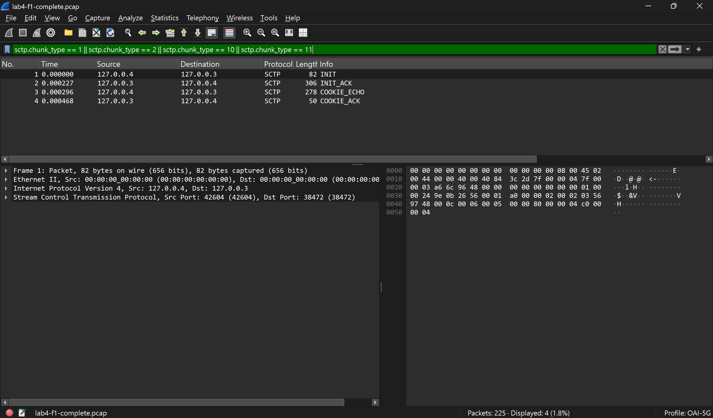

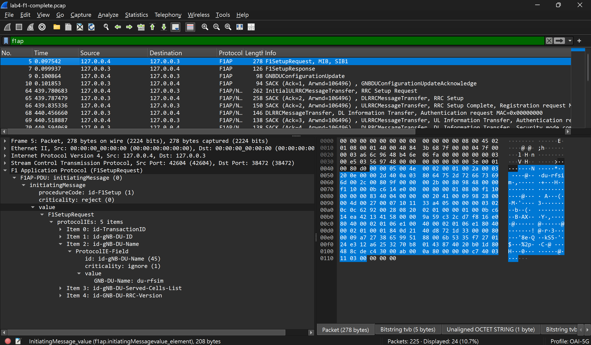

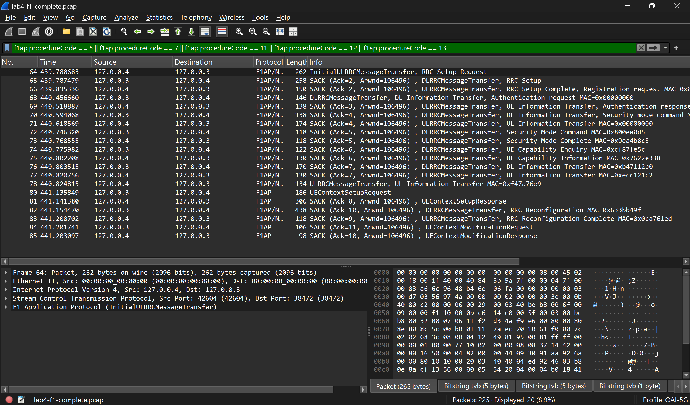

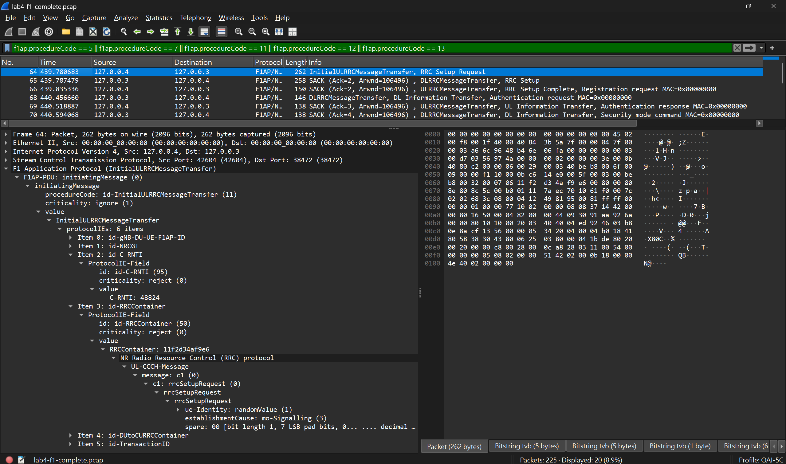

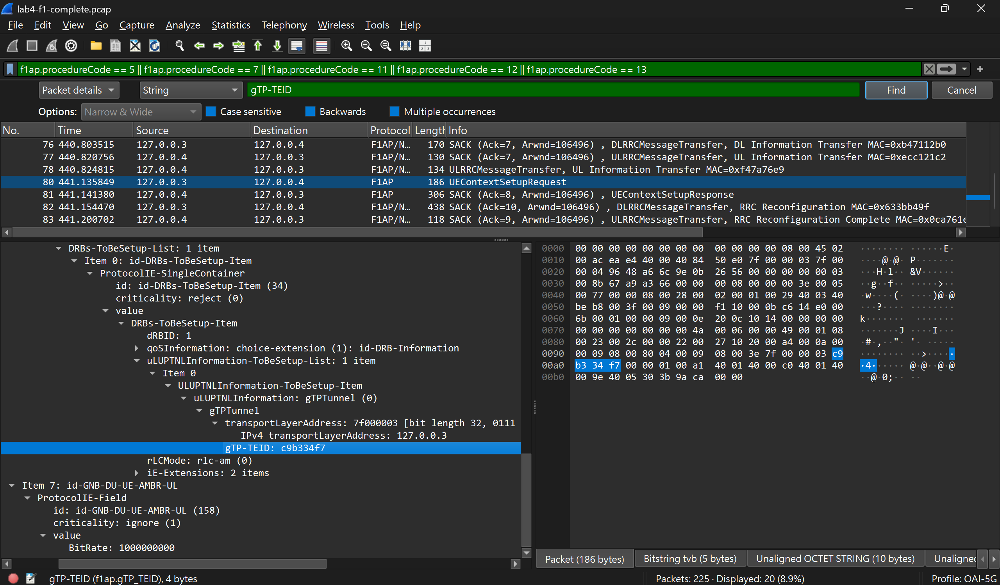

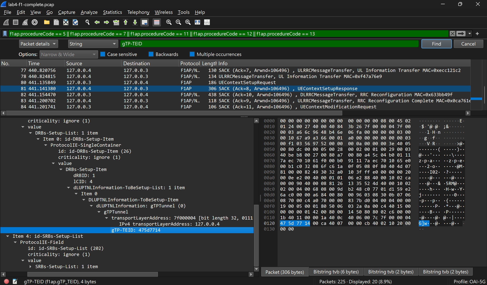

---

## 7. Task 5 — Analyze F1-U (GTP-U / UDP)

In the **same PCAP**, apply:

```text
gtp
```

If necessary, first check:

```text
udp.port == 2152
```

Directional display filters (based on the observed classroom CU/DU IP pair):

```text
gtp && ip.src == 127.0.0.4 && ip.dst == 127.0.0.3
gtp && ip.src == 127.0.0.3 && ip.dst == 127.0.0.4
```

In the captured GTP-U packet details, inspect:

```text
Internet Protocol (outer CU/DU addresses)
  User Datagram Protocol
    GPRS Tunneling Protocol (GTP-U)
      Message Type: G-PDU / T-PDU
      Tunnel Endpoint Identifier (TEID)
      Encapsulated user payload (if decodable)
```

**Important:** The classroom trace showed repeated `GTP T-PDU` packets from `127.0.0.4` (DU) to `127.0.0.3` (CU), confirming traffic on the CU–DU user-plane path. The actual TEID was **not recorded** in the provided screenshot: read the TEID from your own packet details instead of assuming a value.

**My packet details** (summary: [`logs/task5-f1u-gtpu.txt`](logs/task5-f1u-gtpu.txt)):

| Field | Uplink (DU → CU), e.g. #117 | Downlink (CU → DU), e.g. #118 |
|---|---|---|
| Internet Protocol (outer) | 127.0.0.4 → 127.0.0.3 | 127.0.0.3 → 127.0.0.4 |
| User Datagram Protocol | 2152 → 2152 | 2152 → 2152 |
| Message Type | T-PDU (0xff) | T-PDU (0xff) |
| **TEID** | **0xc9b334f7** (allocated by CU, sent in #80) | **0x475d7714** (allocated by DU, sent in #81) |
| Encapsulated payload | No extension header (GTP flags 0x30); PDCP PDU (3-byte header `80 00 06`, 18-bit SN, + IPv4 ICMP Echo Request 10.0.0.2 → 192.168.70.135); not decoded by Wireshark | GTP flags 0x34 with NR RAN Container (0x84) + PDCP PDU (ICMP Echo Reply) |
| **Packet count** | **47** = 40 Echo Requests + 7 IPv6 Router Solicitations | **40** = 40 Echo Replies |

**Why the counts differ:** The two pings sent 10 + 30 = 40 echo requests, and all 40 replies came back. The 7 extra UL packets (#86–#145) contain IPv6 to `ff02::2` with ICMPv6 type 0x85. These are Router Solicitations that `oaitun_ue1` sends on its own, and the same 7 also appear on N3. The TEIDs match the F1AP negotiation and both logs (CU line 87, DU line 439).

### Distinguish F1-U from N3

Both **F1-U** and **N3** can use GTP-U. Do **not** classify traffic as F1-U solely because Wireshark says `GTP` or the port is `2152`.

- **F1-U:** GTP-U between **gNB-DU and gNB-CU**.
- **N3:** GTP-U between **gNB-CU and 5GC UPF**.

Identify the interface using the actual source/destination endpoints and configuration.

The comparison below uses my parallel N3 capture ([`lab4-n3.pcap`](lab4-n3.pcap), [`logs/task5-n3-gtpu.txt`](logs/task5-n3-gtpu.txt)):

| | **F1-C** | **F1-U** | **N3** |
|---|---|---|---|
| Between | gNB-DU ↔ gNB-CU | gNB-DU ↔ gNB-CU | gNB-CU ↔ UPF |
| Endpoints (interface) | 127.0.0.4:42604 ↔ 127.0.0.3:38472 (`lo`) | 127.0.0.4 ↔ 127.0.0.3, UDP 2152 (`lo`) | 192.168.70.129 ↔ 192.168.70.134, UDP 2152 (`oai-cn5g`) |
| Stack | F1AP / SCTP | GTP-U (+ NR-U) / UDP | GTP-U / UDP |
| Payload | RRC containers, UE/cell context | PDCP PDUs (not decodable) | Plain user IP packets (ICMP decoded) |
| TEID UL / DL | — | 0xc9b334f7 / 0x475d7714 | 0x00000001 / 0x401e9cc6 |
| GTP extension header | — | DL: NR RAN Container 0x84; UL: none (flags 0x30) | PDU Session Container 0x85, QFI = 1 (both directions) |
| Set up by | SCTP + F1 Setup | F1AP UE Context Setup (#80/#81) | NGAP PDU Session Resource Setup |
| This run | 24 F1AP frames | 47 UL / 40 DL | 47 UL / 40 DL |

The same 87 user packets cross both hops, which confirms the path UE → DU → **F1-U** → CU → **N3** → UPF → DN.

**Questions**

1. **Which transport protocol carries F1-U?**
   **UDP**, using port **2152** at both ends, with GTP-U on top (#117). Inside GTP-U, F1-U can add the NR-U protocol (TS 38.425) as an extension header for sequence numbering and flow control. In this capture, only the DL packets (CU → DU, e.g. #118) carry it as an NR RAN Container (0x84); the UL packets (e.g. #117, GTP flags 0x30) have no extension header.

2. **What does a GTP-U TEID identify?**
   A TEID identifies the **tunnel endpoint at the receiving node**, which means one bearer. On F1-U that is one DRB of one UE; on N3 it is one PDU session. The receiver allocates the TEID and signals it to the peer, so each direction uses a different value. Here the CU allocated 0xc9b334f7 for UL (#80) and the DU allocated 0x475d7714 for DL (#81). The outer IP addresses only identify the nodes, so the TEID is what maps a packet to the right UE bearer and PDCP entity.

3. **Which direction is `127.0.0.4 → 127.0.0.3` in this setup?**
   **Uplink, from DU to CU.** #117 carries the UE's ICMP **Echo Request** (10.0.0.2 → 192.168.70.135) with the UL TEID 0xc9b334f7. Its Echo Reply (#118) travels in the opposite direction.

4. **How would you distinguish F1-U from N3 in a packet capture?**
   Not by the "GTP" label or port 2152, because both interfaces use them. Instead, use the differences in the table above:
   - the **endpoint IPs**, compared against the configuration: the DU/CU F1 addresses for F1-U, versus the CU's NG-U address and the UPF for N3;
   - the **TEIDs**, matched to F1AP or NGAP signalling;
   - the **extension header**: 0x84 (NR RAN Container) on DL F1-U and none on UL F1-U in this capture, versus 0x85 (PDU Session Container) with a QFI in both directions on N3;
   - the **payload**: a PDCP PDU on F1-U, versus a plain IP packet on N3.

5. **Why do F1-C and F1-U use different transport protocols?**
   F1-C carries signalling, which must arrive **reliably and in order**. SCTP provides this, along with message framing, multiple streams without head-of-line blocking, multi-homing and heartbeats, which is the same reason NGAP and XnAP use SCTP. F1-U carries bulk user data, where **low overhead and latency** matter more. Reliability for that data already comes from RLC ARQ, NR-U delivery status and end-to-end TCP, so retransmission at the transport layer would only add delay. GTP-U over UDP also gives simple per-bearer tunnelling, the same as on N3.

**Evidence:** Screenshot of at least one GTP-U T-PDU, with outer IP addresses, UDP ports, message type, and TEID visible. Record the observed UL and DL packet counts (if both directions are present). Do not assume equal counts.

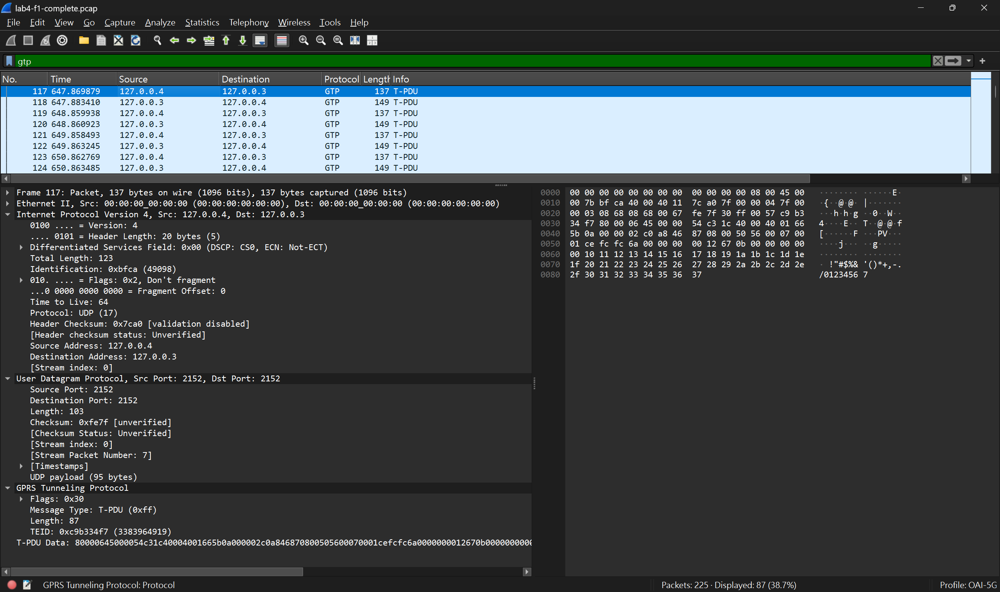

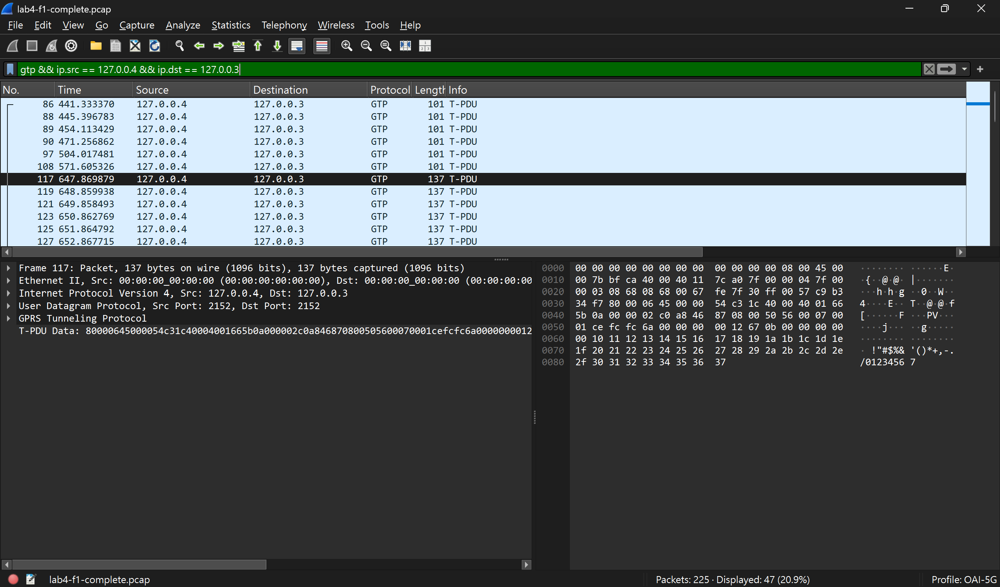

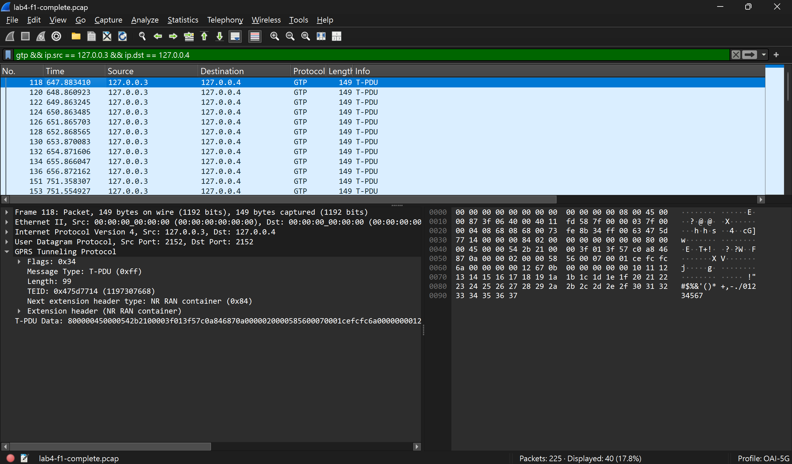

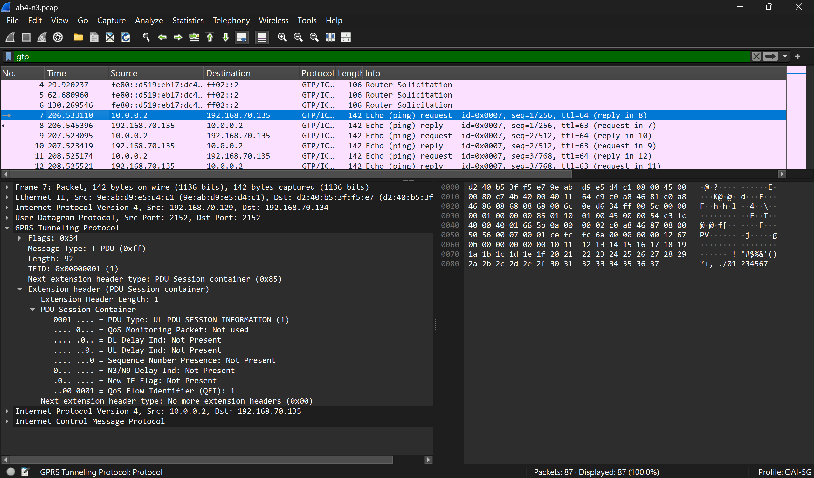

Observed counts: **UL 47, DL 40**. They are not equal; the explanation is given above.

---

## 8. Task 6 — Compare monolithic and split gNB

Complete the table:

| Feature | Lab 3: Monolithic gNB | Lab 4: CU/DU Split |
|---|---|---|
| Number of RAN processes | 1 `nr-softmodem` | 2 `nr-softmodem` (CU + DU) |
| Location of RRC/PDCP | The single gNB process | gNB-CU |
| Location of RLC/MAC/PHY | The single gNB process | gNB-DU |
| F1-C interface present? | No (internal calls) | Yes: F1AP/SCTP, 24 F1AP frames |
| F1-U interface present? | No | Yes: GTP-U/UDP 2152, 47 UL + 40 DL T-PDUs |
| UE connected to the same 5GC? | Yes, OAI CN5G (AMF 192.168.70.132) | Yes, the same CN5G and AMF, same IMSI, PDU session 10 |
| End-to-end Ping works? | Yes: 10/10, 0 % loss, avg 32.384 ms | Yes: 10/10, 0 % loss, avg 28.747 ms; 30/30, avg 23.657 ms |

Explain in **3–5 sentences** why splitting a gNB changes the internal RAN interfaces but does not change the UE's need for synchronization, registration and a PDU session.

The CU/DU split only draws a new boundary inside the gNB: RRC/PDCP go to the CU and RLC/MAC/PHY go to the DU. Messages that a monolithic gNB passes as internal function calls now travel over F1-C and F1-U. The UE cannot see this boundary, because the NR air interface is unchanged. The UE must still synchronize to the cell broadcast by the DU, perform random access and set up RRC (now with the CU's RRC, through the DU). Toward the core, the CU still acts as one gNB with the same N2/N3 interfaces, so the UE must still register with the AMF and establish a PDU session before any data flows, exactly as in Lab 3.

---

## 9. Troubleshooting

| Symptom | First checks |
|---|---|
| DU cannot establish F1 Setup | CU running; CU/DU F1 IP and ports; SCTP association; `f1ap` capture |
| UE repeatedly fails to decode SIB1 | Verify DU `absoluteFrequencySSB` and UE `-C`; check PHY/MAC synchronization and DU logs |
| UE syncs but Registration fails | Check CU/AMF logs, subscriber credentials (IMSI/key/OPc), RRC/NAS progress |
| UE attaches but no `oaitun_ue1` | Check PDU Session Establishment, 5GC SMF/UPF and UE logs |
| Ping fails | Confirm the tunnel, external DN reachability, routing, and user-plane path |
| Only F1AP appears in PCAP | Run Ping; verify PDU session; verify F1-U endpoints/port and capture interface |
| GTP appears but could be N3 | Check source/destination IPs against DU, CU and UPF addresses |
| Wireshark does not decode UDP 2152 as GTP-U | Examine UDP payload and optionally use **Analyze → Decode As…** |

**Do not** assume a screenshot of F1 Setup proves that UE Registration and end-to-end connectivity have succeeded. Validate each stage separately.

*None of these symptoms occurred in my run. Each stage was validated separately:*
- *F1 Setup:* PCAP #1–#10.
- *Sync and SIB1:* UE log lines 78–84.
- *Registration:* PCAP #66–#78 and UE log line 159.
- *PDU session and tunnel:* PCAP #80–#85 and UE log line 182.
- *User plane:* GTP-U and Ping.
- *N3:* checked against the separate N3 capture.

---

## 10. Submission checklist

Submit **one Markdown or PDF report** and **one PCAP file** containing:

- [x] CU/DU configuration summary and frequency check.
- [x] CU/DU and nrUE running evidence.
- [x] UE tunnel IP and successful Ping result (loss and RTT).
- [x] One PCAP containing **F1-C and F1-U**: [`lab4-f1-complete.pcap`](lab4-f1-complete.pcap).
- [x] F1 Setup Request/Response screenshot.
- [x] Three or more UE-related F1AP messages with explanation.
- [x] At least one GTP-U T-PDU screenshot with TEID and endpoints.
- [x] Explanation distinguishing F1-C, F1-U and N3.
- [x] Completed monolithic-vs-split comparison table.
- [x] Answers to all analysis questions.

All screenshots, packet numbers, TEIDs and measurements come from **my own experiment** on 2026-11-18.

---

## 11. Stop the experiment

Stop nrUE, DU and CU with `Ctrl+C`. Then stop CN5G:

```bash
cd ~/wc_2026/oai-cn5g
docker compose down
```

*Done after all evidence was collected.*

**Takeaway:** In the same OAI 5G SA network, **F1-C** exchanges RAN control signaling between CU and DU using **F1AP/SCTP**, while **F1-U** transports UE user-plane data between CU and DU using **GTP-U/UDP**. A successful UE Ping validates the end-to-end data path, while the PCAP shows what happens on the internal split-RAN interface.
